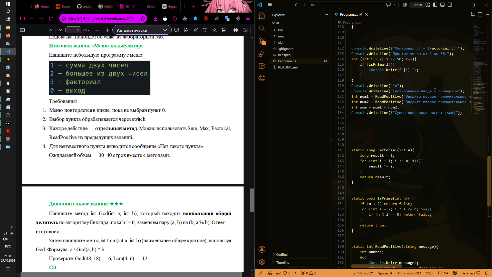
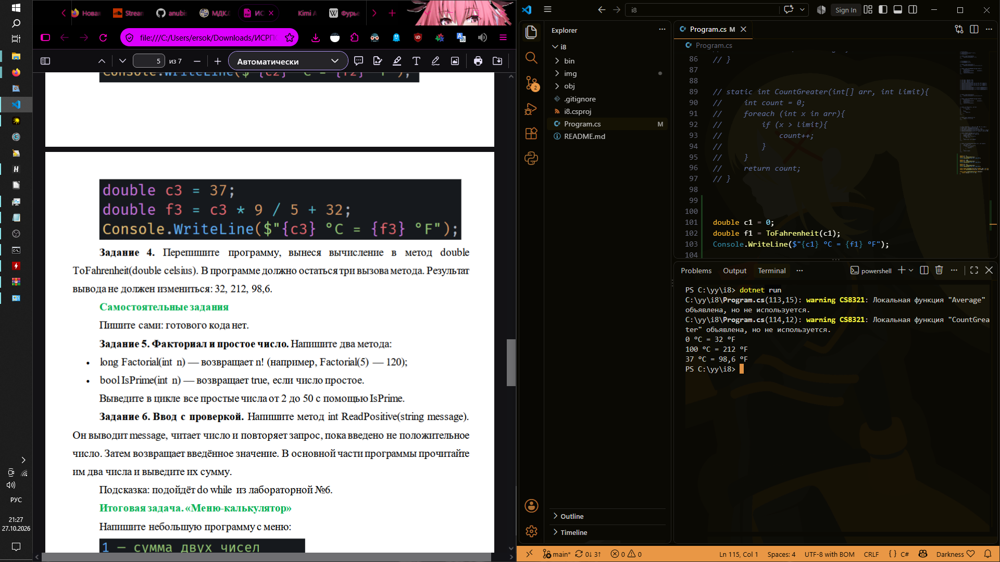

# ISRPO 8
**ФИО:** Чумаченко Михаил
**Группа:** ИСП-242

## Что изучено
- **Объявление и вызов методов:** Научился разбивать программу на логические блоки, создавать собственные методы с параметрами и вызывать их в нужных частях кода.
- **Возврат значений через return:** Разобрал разницу между `void`-методами, которые просто выполняют код, и методами с типом данных, которые обязательно должны возвращать результат с помощью оператора `return`.
- **Оптимизация кода:** Узнал, как избавляться от дублирования кода, вынося повторяющиеся алгоритмы (например, валидацию ввода или математические расчеты) в отдельные переиспользуемые методы.

## Скриншоты

